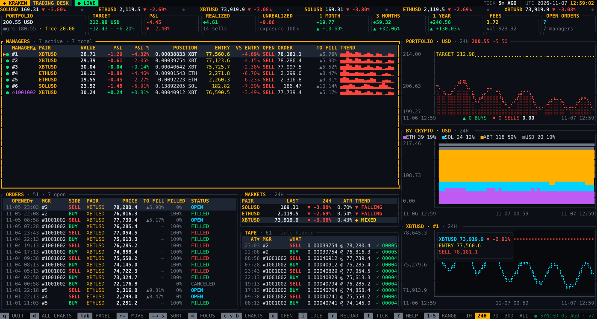
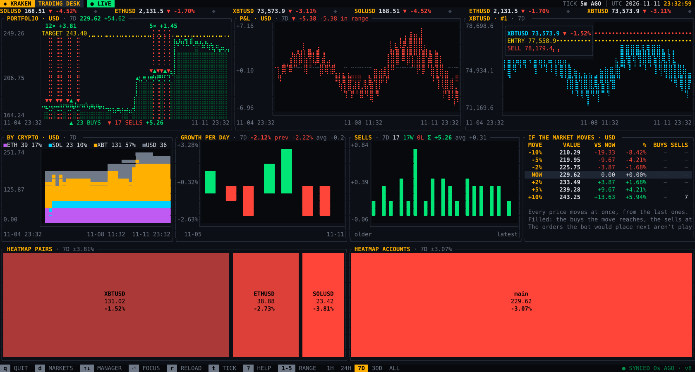
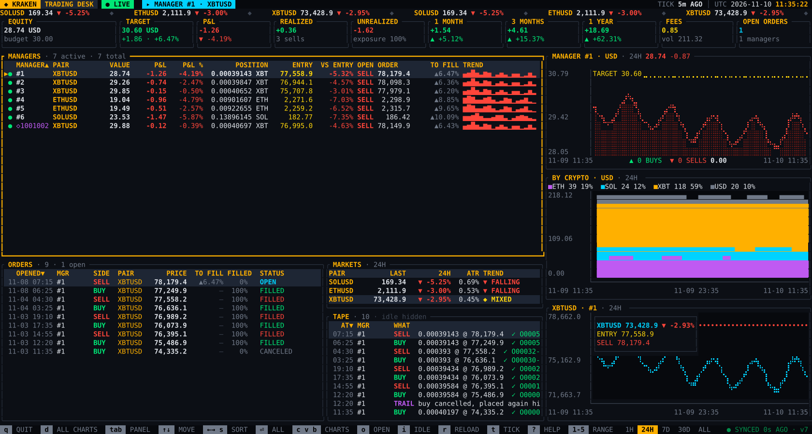

# kraken-trading-bot

> A trading bot on Kraken Spot, its terminal dashboard and its notifications on the phone

Each **manager** trades its own budget on one pair, with limit orders only: it buys below the
market, then sells for what it cost plus a margin, fees included, and starts again with what the
sale brought. Several managers share an account, several Kraken accounts run the same managers,
and the bot adds **virtual managers** when the account has money no manager uses.

It runs on [`kraken-spot-api`](https://crates.io/crates/kraken-spot-api), the Kraken Spot REST
client of [kraken-rust](https://github.com/crypt0p1a/kraken-rust), from crates.io.



## Quick start

```sh
cp managers.example.yaml managers.yaml   # the managers: a dry run until dry_run: false
cp .env.example .env                     # the Kraken API key, never with Withdraw Funds
docker compose up -d --build
docker compose logs -f
docker compose exec kraken-trading-bot kraken-dashboard   # the dashboard, in the terminal
```

Everything else, from the configuration to the database, is in the
[documentation of the bot](docs/trading-bot.md).

## Screenshots

The dashboard on its demo database, 7 days of a simulated market traded by the strategy of the bot:

| Every chart (`d`) | A manager focused on (`⏎`) |
|---|---|
|  |  |

They're drawn, not taken: `scripts/screenshots.sh` renders the screens of the dashboard as SVG
images in `assets/screenshots`, from the demo database. Run it before a release, and whenever a
screen changes.

## Keeping the machine awake

The bot runs in Docker: while the machine sleeps, it's frozen and places nothing, its orders
already on Kraken staying there. It catches up at the first tick after the wake up. To keep the
machine awake while it runs:

```sh
# macOS: no sleep as long as the command runs (-i: idle, -s: on mains power), the screen may turn off
caffeinate -is docker compose logs -f
caffeinate -is docker compose exec kraken-trading-bot kraken-dashboard

# macOS: never on mains power, until it's set back (`pmset -g` shows the current value first)
sudo pmset -c sleep 0

# Linux (systemd): no sleep as long as the command runs
systemd-inhibit --what=idle:sleep --why="kraken-trading-bot" docker compose logs -f

# Windows (PowerShell, as administrator): never on mains power, until it's set back
powercfg /change standby-timeout-ac 0
```

Closing the lid of a laptop still puts it to sleep, unless it's on mains power with an external
screen. A machine that never sleeps, a small server, is the right place for a bot trading real
money.

## Crates

```text
crates/
├── kraken-trading-bot  the bot: managers, strategy, SQLite database (executable, Docker)
├── kraken-dashboard    its dashboard in the terminal (ratatui), live from its database
└── trading-notify      notifications of a trading bot through ntfy, in several languages
```

| Crate | What's in it |
|-------|--------------|
| `kraken-trading-bot` | the [managers](docs/trading-bot.md#configuration), [several accounts](docs/trading-bot.md#several-accounts), [virtual managers](docs/trading-bot.md#virtual-managers), the [indicators of the market](docs/trading-bot.md#indicators-of-the-market) and the [database](docs/trading-bot.md#database) |
| `kraken-dashboard` | the [dashboard](docs/trading-bot.md#dashboard): P&L, managers, orders, markets, decisions, charts and heatmaps |
| `trading-notify` | the [notifications](docs/trading-bot.md#notifications): languages, texts, sending through ntfy |

## Development

```sh
git config core.hooksPath .githooks   # refuses a commit holding a secret (gitleaks)
cargo test --workspace                # the offline tests
cargo run -p kraken-trading-bot -- --check   # checks the configuration, the pairs and the API keys
```

The [CI](docs/ci.md) runs the tests on Linux, macOS and Windows, the coverage, the secret
scanners and the Docker image.

## History

The bot started in [kraken-rust](https://github.com/crypt0p1a/kraken-rust), next to the Kraken
client. Its commits were moved here one by one, with their messages, authors and dates.

## License

[MIT](LICENSE)
