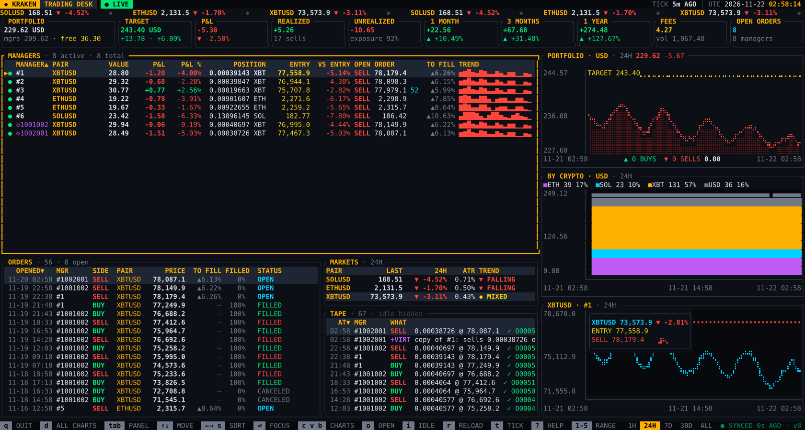
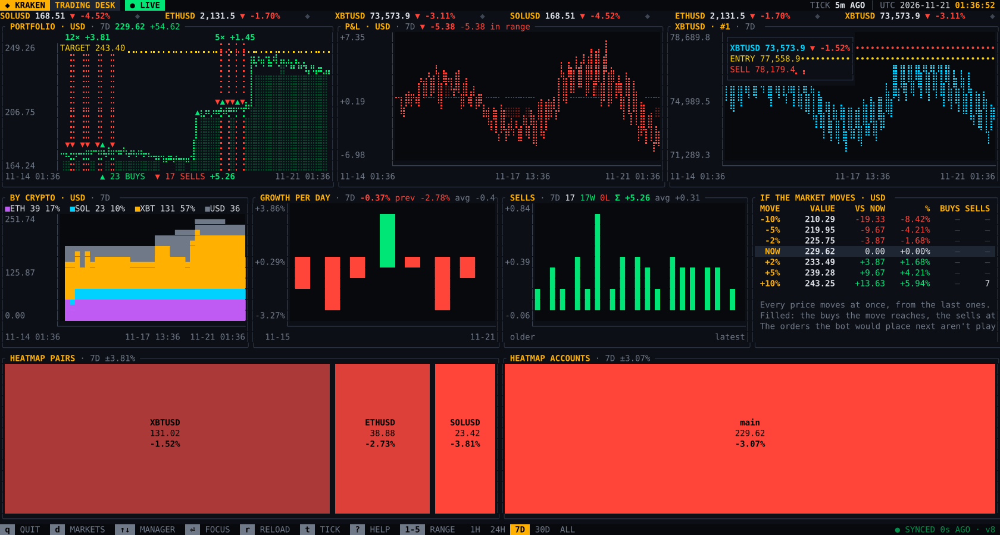
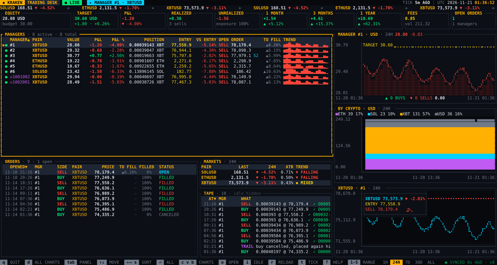
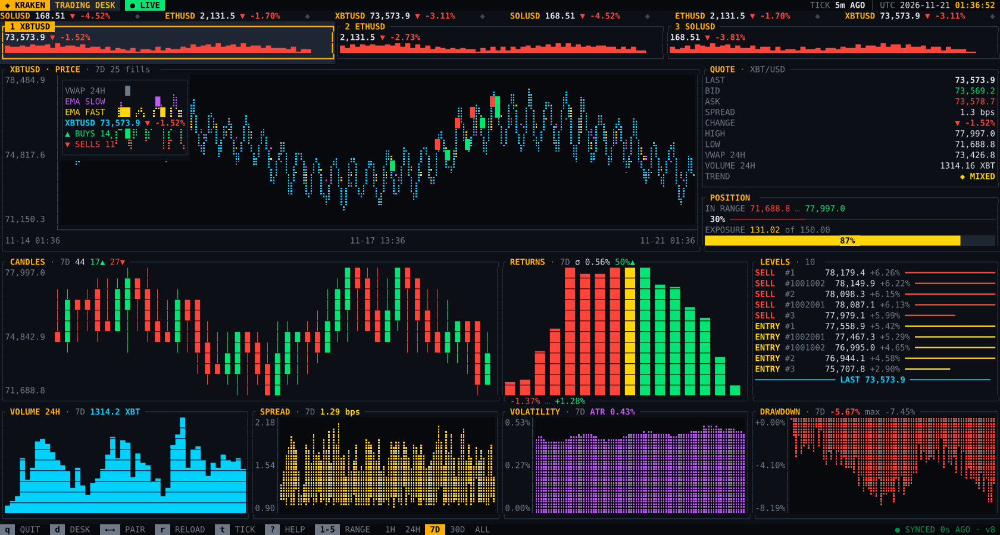

# kraken-trading-bot

> An open source **crypto trading bot for Kraken**, written in Rust: it scalps with limit orders,
> shows everything in a terminal dashboard and notifies your phone

[](https://github.com/crypt0p1a/kraken-trading-bot/actions/workflows/ci.yml)
[](Cargo.toml)
[](LICENSE)
[](https://invite.kraken.com/JDNW/iuba05c7)
[](https://www.linkedin.com/in/kevin-le-perf)

Each **manager** trades its own budget on one pair, with limit orders only: it buys below the
market, then sells for what it cost plus a margin, fees included, and starts again with what the
sale brought. Several managers share an account, several Kraken accounts run the same managers,
and the bot adds **virtual managers** when the account has money no manager uses.

It runs on [`kraken-spot-api`](https://crates.io/crates/kraken-spot-api), the Kraken Spot REST
client of [kraken-rust](https://github.com/crypt0p1a/kraken-rust), from crates.io.



## Features

- **Kraken Spot**, on any pair Kraken trades: Bitcoin (XBT), Ethereum, Solana… against USD, EUR or
  any other quote
- **Limit orders only**: never a market, margin or stop order, each order checked before it
  reaches Kraken
- **A dry run first**: Kraken only validates the orders until the configuration says
  `dry_run: false`
- **Several managers on several Kraken accounts**, and virtual managers for the money and the
  crypto no manager uses
- **Trailing buys**: a buy the price left behind is cancelled and placed again higher
- **A terminal dashboard** ([ratatui](https://ratatui.rs)): P&L, managers, orders, markets,
  candles and heatmaps, live from the database
- **Notifications on the phone** through [ntfy](https://ntfy.sh), in English or French
- **Everything kept in SQLite**: the orders, the decisions, the prices, the value of the account
- **A Docker image** for amd64 and arm64; `--check` tells when the API key could withdraw funds

## Quick start

It needs a Kraken account and an API key of it. No account yet? The 🐙 Kraken badge above is
[my invitation link](https://invite.kraken.com/JDNW/iuba05c7), a referral link.

```sh
cp managers.example.yaml managers.yaml   # the managers: a dry run until dry_run: false
cp .env.example .env                     # the Kraken API key, never with Withdraw Funds
docker compose up -d --build
docker compose logs -f
docker compose exec kraken-trading-bot kraken-dashboard   # the dashboard, in the terminal
```

Everything else, from the configuration to the database, is in the
[documentation of the bot](docs/trading-bot.md).

## Screenshots

The dashboard on its demo database, 7 days of a simulated market traded by the strategy of the bot:

| Every chart (`d`) | A manager focused on (`⏎`) |
|---|---|
|  |  |

| The markets, a pair at a time (`d` twice) | |
|---|---|
|  | |

They're drawn, not taken: `scripts/screenshots.sh` renders the screens of the dashboard as SVG
images in `assets/screenshots`, from the demo database. Run it before a release, and whenever a
screen changes.

## Keeping the machine awake

The bot runs in Docker: while the machine sleeps, it's frozen and places nothing, its orders
already on Kraken staying there. It catches up at the first tick after the wake up. To keep the
machine awake while it runs:

```sh
# macOS: no sleep as long as the command runs (-i: idle, -s: on mains power), the screen may turn off
caffeinate -is docker compose logs -f
caffeinate -is docker compose exec kraken-trading-bot kraken-dashboard

# macOS: never on mains power, until it's set back (`pmset -g` shows the current value first)
sudo pmset -c sleep 0

# Linux (systemd): no sleep as long as the command runs
systemd-inhibit --what=idle:sleep --why="kraken-trading-bot" docker compose logs -f

# Windows (PowerShell, as administrator): never on mains power, until it's set back
powercfg /change standby-timeout-ac 0
```

Closing the lid of a laptop still puts it to sleep, unless it's on mains power with an external
screen. A machine that never sleeps, a small server, is the right place for a bot trading real
money.

## Crates

```text
crates/
├── kraken-trading-bot     the bot: managers, strategy, SQLite database (executable, Docker)
├── kraken-dashboard       its dashboard in the terminal (ratatui), live from its database
├── kraken-dashboard-data  what the dashboard shows, read from the database (shared, serializable)
└── trading-notify         notifications of a trading bot through ntfy, in several languages
```

| Crate | What's in it |
|-------|--------------|
| `kraken-trading-bot` | the [managers](docs/trading-bot.md#configuration), [several accounts](docs/trading-bot.md#several-accounts), [virtual managers](docs/trading-bot.md#virtual-managers), the [indicators of the market](docs/trading-bot.md#indicators-of-the-market) and the [database](docs/trading-bot.md#database) |
| `kraken-dashboard` | the [dashboard](docs/trading-bot.md#dashboard): P&L, managers, orders, markets, decisions, charts and heatmaps |
| `kraken-dashboard-data` | what the dashboard shows, read from the database of the bot, as JSON too: shared by the dashboard and the bot |
| `trading-notify` | the [notifications](docs/trading-bot.md#notifications): languages, texts, sending through ntfy |

## Development

```sh
git config core.hooksPath .githooks   # refuses a commit holding a secret (gitleaks)
cargo test --workspace                # the offline tests
cargo run -p kraken-trading-bot -- --check   # checks the configuration, the pairs and the API keys
```

The [CI](docs/ci.md) runs the tests on Linux, macOS and Windows, the coverage, the secret
scanners and the Docker image.

## History

The bot started in [kraken-rust](https://github.com/crypt0p1a/kraken-rust), next to the Kraken
client. Its commits were moved here one by one, with their messages, authors and dates.

## Disclaimer

**This is not financial advice.** I'm not a trader and I have no training in finance: this bot is
what a developer built to learn, and its strategy is only what I understood of the market. Trading
crypto can lose money: run it in dry run first, then with amounts you can afford to lose. It's
provided as is, without warranty, under the MIT license.

**I'd really like your feedback.** Everything here is open to review, the strategy as much as the
code: an [issue](https://github.com/crypt0p1a/kraken-trading-bot/issues) or a pull request
pointing out what's wrong, risky or naive is the most useful thing you can send.

**Not affiliated with Kraken.** Kraken is a trademark of Payward, Inc., the company behind the
Kraken exchange: this project is independent, neither endorsed nor supported by Kraken or
Payward. It only uses the public [Kraken Spot REST API](https://docs.kraken.com/api/).

## Author

Kevin Le Perf

[](https://www.linkedin.com/in/kevin-le-perf)

## License

[MIT](LICENSE)
